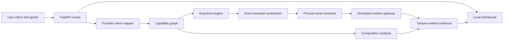
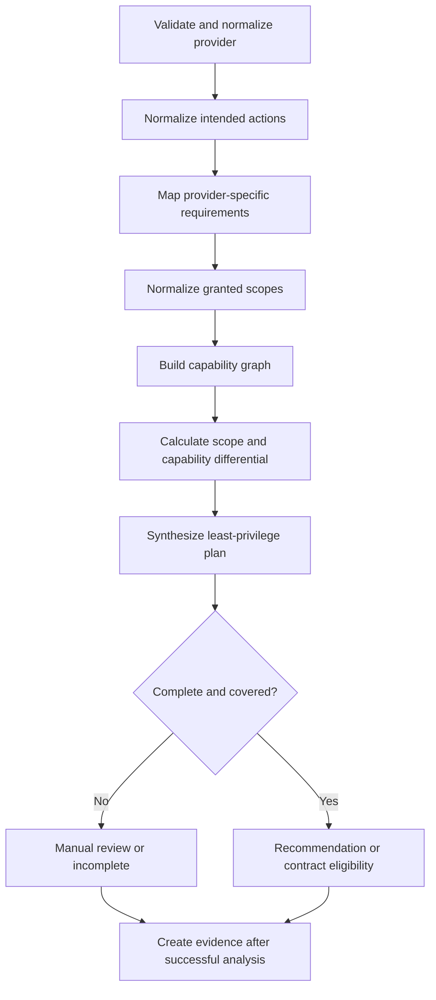
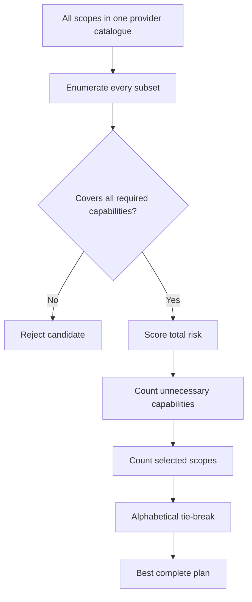
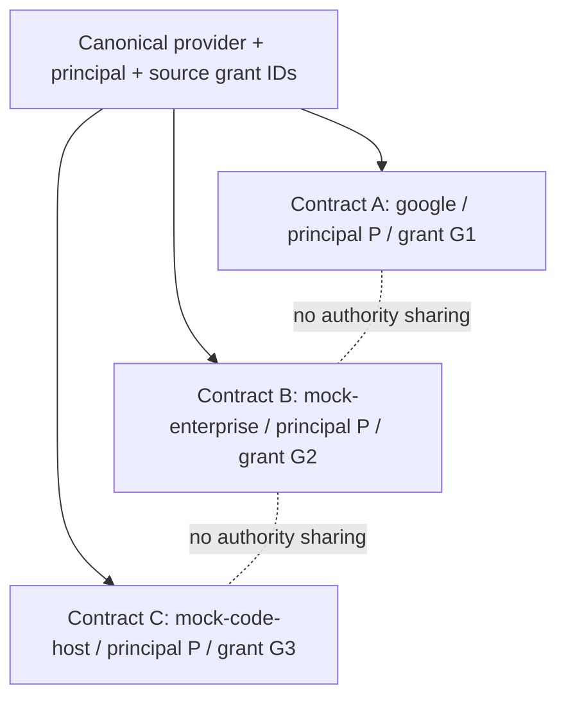
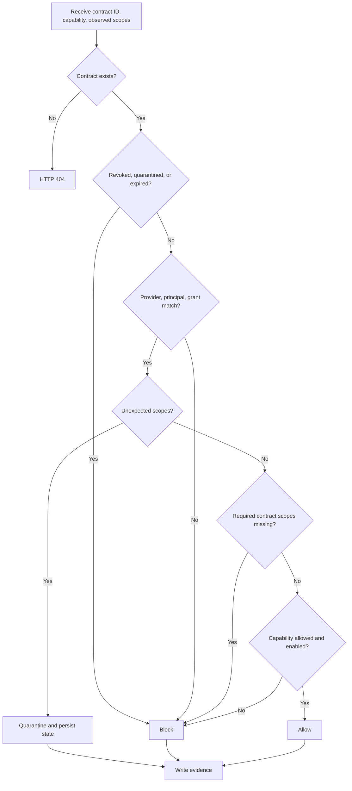
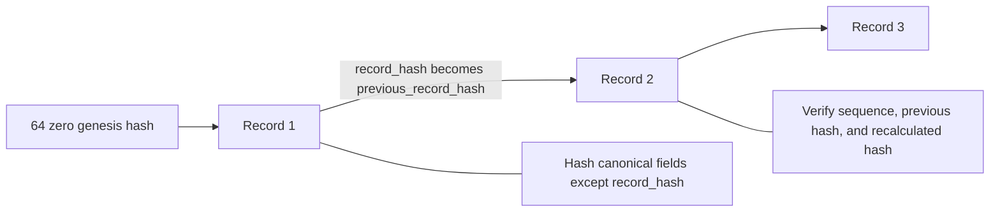
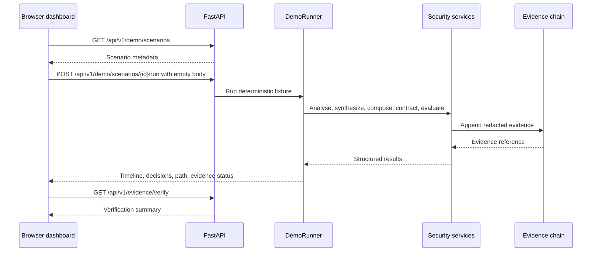

# ScopeSentry-R: Complete Project Understanding and Faculty Explanation Guide

**Educational technical guide for project understanding, demonstration, and viva preparation**

ScopeSentry-R is a credential-free proof of concept for analysing OAuth authority against a user's stated intent. It represents permissions as provider-qualified capabilities, identifies excessive and missing authority, synthesizes a bounded least-privilege scope set, creates isolated process-local contracts, evaluates supplied runtime observations, detects unauthorized composed data paths, and records decisions in a tamper-evident hash chain. This guide explains what the project implements, how the parts fit together, what the local experiments show, and what the project does not claim.

**Status vocabulary used throughout this guide**

- **Implemented:** present in the repository and exercised by automated tests or deterministic scenarios.
- **Partially implemented:** the decision logic exists, but a production mechanism such as real traffic interception or durable storage does not.
- **Simulated:** demonstrated with deterministic local providers and supplied runtime observations, without real OAuth credentials.
- **Future concept:** a reasonable extension that is not part of the current code.

---

## Part I — Project introduction

### 1.1 Project title

**ScopeSentry-R: Intent-Locked OAuth Capability Security**

### 1.2 A simple real-world analogy

Imagine a university gives a temporary visitor a key card because the visitor needs to read one file in the library. A conventional check may ask only, “Does this card open the library?” ScopeSentry-R asks more questions: “What did the visitor say they needed to do? Which rooms does the card actually open? Can those rooms be combined into a route to a mail room? Did a new door appear on the card later? Does the card being used now match the temporary agreement?” The system then recommends the smallest suitable key-card profile, creates a short-lived agreement, checks supplied observations against it, and records each decision so later changes to the audit history can be detected.

### 1.3 One-paragraph project summary

ScopeSentry-R turns an intended action, such as “read files,” into provider-specific required scopes and capabilities. It compares this requirement with granted scopes, builds a provider-qualified capability graph, measures excessive and missing authority, and searches the finite local catalogue for the lowest-risk supported scope combination. If the result is safe and complete, it creates an isolated capability contract bound to a canonical provider, principal, and grant. A simulated gateway evaluates supplied runtime scope observations and attempted capabilities in a fail-closed order. A composition engine separately compares observed data-flow links with exact authorized-flow declarations, including cross-provider flows. Successful analyses and all runtime decisions are linked through a tamper-evident JSON Lines evidence chain. A local dashboard presents these backend results without reproducing the security policy in JavaScript.

### 1.4 Technical domain

The project lies at the intersection of:

- OAuth authorization and delegated access;
- least-privilege access control;
- capability modelling and graph analysis;
- runtime policy evaluation;
- cross-service and cross-provider composition analysis;
- security evidence and audit integrity;
- explainable cybersecurity demonstrations.

### 1.5 Problem statement

OAuth applications are commonly assessed by comparing requested scope strings with an allowlist or a set of required scopes. That comparison can miss four important facts. First, a grant can contain unrelated authority beyond the user's intent. Second, authority observed at runtime can differ from the authority used to create a plan. Third, identical scope or capability text can belong to different providers or principals. Fourth, individually acceptable grants can form an unsafe path when data can move from a read capability to an outbound capability. ScopeSentry-R addresses these problems in a bounded local model by conditioning authority on intent, preserving provenance, evaluating runtime observations against a contract, and comparing observed flows with separately authorized flows.

### 1.6 Motivation

OAuth scopes are useful, but they are often coarse. A user who wants file reading may grant both file reading and mail reading. A static checker can confirm that the required file scope exists and still overlook the unnecessary mail authority. The risk becomes more subtle when several grants are combined, when authority drifts after contract creation, or when the same name is reused by different providers. The motivation is to make these differences explicit and explainable before an operation is treated as authorized.

### 1.7 Project objectives

1. Map normalized user intent to provider-specific required scopes and capabilities.
2. Preserve canonical provider, principal, grant, scope, and capability identity.
3. calculate matched, excessive, and missing authority deterministically.
4. Synthesize the safest exact solution within the configured finite catalogue and risk model.
5. Create temporary, isolated capability contracts only when requirements are completely covered.
6. Evaluate supplied runtime observations in a fail-closed order.
7. Detect unauthorized observed flows within and across providers.
8. Link decisions through tamper-evident evidence.
9. Explain all results through APIs, deterministic scenarios, tests, reports, and a local dashboard.

### 1.8 Target users

The current PoC is most useful to students, researchers, security architects, OAuth application reviewers, and faculty evaluators. It demonstrates design principles that could later be adapted for consent review, token-broker policy, service-mesh authorization, SaaS integration review, or security testing. It is not presently an end-user OAuth client or production enforcement proxy.

### 1.9 Real-world cybersecurity applications

Potential future applications include reviewing overbroad third-party consent, generating least-privilege grant recommendations, validating token-proxy requests, detecting unexpected authority observed by a gateway, assessing workflows that move data between SaaS services, and attaching verifiable decision evidence to security operations. These are application directions; the repository currently demonstrates them only with synthetic local providers.

### 1.10 Scope of the current PoC

The implemented PoC provides FastAPI services, deterministic provider catalogues, 14 scenarios, NetworkX graph construction, exact bounded synthesis, process-local contracts, simulated gateway decision enforcement, supplied runtime observations, exact flow authorization matching, JSON Lines evidence, a safe same-origin dashboard, two evaluation corpora, a release verifier, and live-demo support. It uses no real credentials and requires no network access.

### 1.11 What the system does not claim to do

The project does not claim confirmed patentability, established novelty, formal verification, production readiness, universal attack prevention, real-provider compatibility, autonomous provider telemetry, real token interception, automatic provider revocation, tamper-proof storage, independent validation, or production-grade performance. Real authentication, persistent contracts, distributed evidence locking, signed evidence anchoring, and commercial provider adapters remain future work.

## Part II — Background concepts

### 2.1 OAuth

**Simple explanation.** OAuth lets one application receive limited permission to act with another service without learning the user's password.

**Technical explanation.** An authorization server issues an access token representing delegated authority. A resource server accepts that token for operations allowed by its associated scopes and policies. OAuth defines authorization flows, but provider-specific scope semantics determine what authority a token conveys.

**Project location.** ScopeSentry-R models normalized OAuth-like scopes in `app/providers/catalog.py`; it does not execute a real OAuth flow.

**Example.** `drive.readonly` represents local simulated authority to list files, read metadata, and read file contents.

**Why needed.** OAuth is the authorization context in which excess, missing permission, drift, and composed authority are demonstrated.

### 2.2 Access tokens

An access token is a credential presented to a protected API. Tokens are deliberately absent from this PoC. Requests carry scope names and supplied observations, not bearer credentials. Evidence redaction in `app/evidence/canonical.py` recursively replaces sensitive fields such as `access_token`, `refresh_token`, `authorization`, `client_secret`, `password`, `api_key`, and `cookie` with `[REDACTED]` before storage.

### 2.3 Scopes and capabilities

A **scope** is a provider-defined permission label. A **capability** is the operation that a scope enables in the local model. One scope can enable several capabilities, and a broad scope can include capabilities from narrower scopes.

Example:

| Scope | Selected capabilities in the local catalogue |
|---|---|
| `drive.readonly` | `list_files`, `read_file_metadata`, `read_file_contents` |
| `gmail.send` | `send_email_messages` |
| `content.read` at the code-host provider | `list_repositories`, `read_repository_metadata`, `read_repository_contents` |
| `content.read` at the enterprise provider | `list_enterprise_files`, `read_enterprise_file_metadata`, `read_sensitive_file_contents` |

The last two rows show why provider provenance matters: the same scope text does not represent the same authority.

### 2.4 Least privilege

Least privilege means giving only the authority needed for the intended task. ScopeSentry-R implements **bounded least-privilege synthesis over the configured catalogue and risk model**. It does not prove a globally minimal authorization for every possible provider. It exactly examines combinations from the finite local catalogue.

### 2.5 Excessive and missing authority

- **Excessive authority** is granted but not required by the selected intent. Example: `gmail.readonly` during a file-reading task.
- **Missing authority** is required but absent. Example: `gmail.send` is required for “send email” but only `drive.readonly` was granted.

Both are calculated in `app/planner/exposure_engine.py` and presented in `AnalysisResponse` and `DemoAnalysisSummary`.

### 2.6 Runtime scope drift

Runtime scope drift occurs when the scopes observed during a capability attempt differ from the scopes stored in the contract. In the `runtime-scope-drift` scenario, the contract permits only `drive.readonly`, while the supplied observation includes `gmail.send`. The gateway quarantines the contract.

### 2.7 Confused-deputy and cross-service risk

A confused deputy uses its legitimate authority for a purpose that the requester was not entitled to achieve. Cross-service risk appears when a read grant and an outbound grant can be composed. ScopeSentry-R does not claim to solve all confused-deputy problems, but it models one important pattern: data from a source capability can reach a target capability through an observed link that lacks an exact authorization.

### 2.8 Composed authorization paths

A composition path is a sequence of capability nodes and data-flow edges across one or more grants. A file-reading grant and an email-sending grant may each be acceptable alone, yet an observed `read_file_contents` to `send_email_messages` link can create an unauthorized exfiltration path. `app/planner/composition_engine.py` and `app/planner/cross_provider_composition.py` construct and inspect these paths.

### 2.9 Core identity terms

| Term | Meaning in ScopeSentry-R |
|---|---|
| Adapter ID | Implementation-facing provider name, such as `mock-google`. |
| Canonical provider ID | Security namespace, such as `google`, `mock-enterprise`, or `mock-code-host`. |
| Principal | Local identity on whose behalf a grant exists. |
| Grant | A simulated authorization boundary with an ID, provider, principal, scopes, and status. |
| Scope | Provider-qualified permission label. |
| Capability | Provider-qualified operation enabled by a scope. |
| Intent | Normalized user purpose such as `read_files` or `configure_webhooks`. |
| Observed flow | A possible or seen data connection; it is not authorization. |
| Authorized flow | An exact declaration permitting one qualified source-to-target flow. |

### 2.10 Decision and plan outcomes

| Outcome | Meaning |
|---|---|
| `allow` | The stored contract is active, identities match, scopes match, and the attempted capability is allowed and enabled. |
| `block` | A policy rule denies the attempt without quarantining the contract. |
| `quarantine` | Unexpected authority is observed; the contract becomes quarantined and remains so. |
| `manual_review` | Intent cannot be mapped safely; the system does not claim a complete plan. |
| `incomplete` | The catalogue cannot cover all required capabilities or required authority is missing. |
| Contract not created | The plan is incomplete, requires manual review, lacks granted selected scopes, or composition is unsafe. |

## Part III — Existing problem

### 3.1 How conventional static scope checking works

A conventional checker often performs this operation:

```text
required_scopes = mapping[intent]
if required_scopes is a subset of granted_scopes:
    allow
else:
    deny
```

This is a fair baseline for required-scope coverage. The evaluation class `StaticScopeBaseline` in `app/evaluation/baseline.py` uses this basic model. It permits a case when the required scope is covered and ignores unrelated additional authority. It intentionally does not synthesize a reduced contract, monitor drift, enforce capability attempts, or inspect composition paths.

### 3.2 Why scope names alone are insufficient

A scope name is a provider label, not a complete security identity. The string `content.read` exists in both synthetic enterprise and code-host catalogues. Treating the strings as interchangeable would let an enterprise file grant satisfy a repository intent. ScopeSentry-R prevents this by qualifying authority with canonical provider, principal, grant, and source scope.

### 3.3 Why static comparison misses runtime drift

Static analysis sees only the scopes supplied at analysis time. If runtime observations later contain new authority, the original comparison cannot detect it. ScopeSentry-R stores selected scopes in a contract and compares supplied observed scopes during every gateway evaluation.

### 3.4 Why individually acceptable grants can compose unsafely

A read grant and a send grant can each be legitimate for separate purposes. If data can move from the first grant to the second, the combined system may expose an outbound path that neither isolated grant reveals. The composition engine therefore analyses explicit observed links and separately checks exact flow authorization.

### 3.5 Why broad scopes matter

A broad scope may include the required operation plus delete, administration, or outbound capabilities. Merely proving that the required capability exists does not remove the additional exposure. The project assigns catalogue risk weights and compares capability sets, then searches for a lower-risk supported combination.

### 3.6 Why intent must be considered

Authority is not excessive in isolation; it is excessive relative to a purpose. `gmail.readonly` may be appropriate for “read email” and excessive for “read files.” Intent conditioning provides the reference point for exposure differential, synthesis, contracts, and explanations.

### 3.7 Traditional approach versus ScopeSentry-R

| Concern | Conventional static scope baseline | ScopeSentry-R PoC |
|---|---|---|
| Required-scope presence | Yes | Yes |
| Extra-scope detection | Usually ignored | Explicit excessive-scope and capability sets |
| Provider-qualified identity | Limited to scope namespace assumptions | Canonical provider, principal, grant, scope, and capability |
| Least-privilege recommendation | No | Exact bounded synthesis over the local catalogue |
| Runtime drift | No | Supplied observations compared with stored contract |
| Capability attempt | Not evaluated | Simulated gateway decision enforcement |
| Multi-grant composition | No | NetworkX capability and data-flow graph |
| Cross-provider flow authorization | No | Exact observed-versus-authorized tuple matching |
| Evidence | No | Tamper-evident JSON Lines hash chain |
| Explainability | Usually pass/fail | Differential, plan, reason code, timeline, path, evidence reference |

## Part IV — ScopeSentry-R solution

### 4.1 Intent-conditioned authority analysis

**Purpose.** Establish what authority is actually required by the user's declared task.

**Input.** Canonical provider and intended-action strings.

**Processing.** `normalize_intent()` standardizes case, spaces, and hyphens; `map_provider_intents()` looks up the provider-specific mapping.

**Output.** Required scopes, required capabilities, recognized intents, and unknown intents.

**Source.** `app/planner/intent_mapper.py`, `app/providers/intent_catalog.py`.

**Example.** For canonical provider `google`, “read files” maps to `drive.readonly` and its three read capabilities. The same text for `mock-enterprise` maps to `content.read` and enterprise-specific capabilities.

**Why needed.** Without intent, the system has no safe basis for identifying unnecessary authority.

### 4.2 Provider-qualified identity

**Purpose.** Prevent collisions between providers, principals, and grants.

**Processing.** Immutable identity objects `GrantIdentity`, `ScopeIdentity`, and `CapabilityIdentity` preserve structured fields. NetworkX node IDs are generated from a collision-safe SHA-256 hash of canonical serialized identity data, but structured node attributes remain authoritative.

**Source.** `app/planner/provider_identity.py`, `app/planner/capability_graph.py`.

**Example.** Enterprise `content.read` and code-host `content.read` create distinct scope and capability nodes.

### 4.3 Capability graph

**Purpose.** Show how scopes enable capabilities and how declared data links connect grants.

**Input.** Provider-qualified grants, catalogue entries, and optional data-flow links.

**Processing.** The graph builder adds grant, scope, capability, and resource/data nodes with provenance attributes and typed edges.

**Output.** Serializable nodes, edges, capability paths, and composition findings.

**Source.** `app/planner/capability_graph.py`, `app/planner/composition_engine.py`, `app/planner/cross_provider_composition.py`.

### 4.4 Exposure differential

**Purpose.** Separate required authority from surplus and missing authority.

**Processing.** Normalized sets are compared. The engine also resolves capabilities and sums catalogue risk weights.

```text
matched_scopes   = granted_scopes ∩ required_scopes
excessive_scopes = granted_scopes − required_scopes
missing_scopes   = required_scopes − granted_scopes
exposure_score   = 100 × excessive_scope_risk / total_granted_scope_risk
```

Unknown well-formed public scopes remain untrusted. They can appear as excessive authority but do not grant known capabilities.

**Source.** `app/planner/exposure_engine.py`.

### 4.5 Bounded least-privilege synthesis

**Purpose.** Find the safest supported scope set that covers all required capabilities.

**Processing.** `synthesize_least_privilege()` exhaustively evaluates subsets of the selected provider's finite catalogue. It orders complete candidates by total risk, unnecessary capability count, number of scopes, and alphabetical order.

**Output.** A `LeastPrivilegePlan` with status, selected/keep/remove/add scopes, covered/uncovered/unnecessary capabilities, risk values, reduction percentage, method, and explanation.

**Source.** `app/planner/least_privilege_synthesizer.py`, `app/schemas/analysis.py`.

**Why “bounded exact.”** The selected answer is exact within the configured finite local catalogue and risk model. It is not a universal optimizer for unknown real-provider policies.

### 4.6 Contract construction and isolation

**Purpose.** Convert a complete plan into a temporary authority boundary.

**Input.** Provider, principal, source grant IDs, original grants, intended actions, and TTL.

**Processing.** `create_contract()` reuses mapping, analysis, graph, and synthesis services. It does not trust client-supplied capabilities. Selected scopes must be covered by the grant before an active contract is created.

**Output.** A `CapabilityContract` containing a UUID, canonical provider, principal, source grants, allowed scopes and capabilities, scope fingerprint, timestamps, state, policy version, and source evidence references.

**Source.** `app/gateway/contracts.py`, `app/gateway/service.py`, `app/gateway/repository.py`, `app/schemas/gateway.py`.

**Isolation rule.** A contract does not combine unrelated providers. The repository stores deep copies and is process-local.

### 4.7 Runtime decision ordering

**Purpose.** Evaluate supplied runtime observations consistently and fail closed.

**Order.** Unknown contract; revoked/quarantined/expired state; provider mismatch; principal mismatch; grant mismatch; unexpected or missing observed scopes; capability authorization; capability enablement; allow.

**Source.** `app/gateway/service.py`, `app/gateway/policy_engine.py`.

### 4.8 Observed-versus-authorized flows

**Purpose.** Avoid treating a declared or observed link as permission.

An authorized cross-provider flow must match all fields: source provider, principal, grant, capability, data type, target provider, principal, grant, and capability. There are no wildcard authorizations in this phase. An observed link without a matching authorization is unauthorized by default.

### 4.9 Tamper-evident evidence

**Purpose.** Make later alteration, deletion, reordering, or broken linkage detectable under local file-storage assumptions.

**Processing.** Requests and results are redacted and canonically serialized. SHA-256 hashes are linked using the previous record's hash. Writes use an in-process lock, append one compact JSON object per line, flush, and synchronize the file.

**Source.** `app/evidence/canonical.py`, `app/evidence/hash_chain.py`, `app/evidence/service.py`, `app/schemas/evidence.py`.

### 4.10 Explainable dashboard

**Purpose.** Present backend decisions for faculty demonstration.

**Processing.** Same-origin JavaScript calls existing APIs and renders with `textContent`, `createElement`, safe attributes, and `replaceChildren`. It does not independently calculate security decisions.

**Source.** `app/static/dashboard/index.html`, `styles.css`, `dashboard.js`; served by `app/main.py` at `/demo` and `/demo-assets`.

## Part V — Complete architecture

### 5.1 Overall architecture



*Figure 1. Overall ScopeSentry-R architecture. Synthetic providers and supplied observations remain inside the local PoC boundary.*

The API layer orchestrates reusable services. Provider catalogues define authoritative scope-to-capability and risk metadata. The graph and exposure services explain authority. The synthesizer produces a plan. The gateway creates and evaluates process-local contracts. Composition analysis is a separate path check. Evidence records successful analyses and decisions. The dashboard reads these API results.

### 5.2 Request-processing flow



*Figure 2. Analysis request flow implemented by the planner and API services.*

### 5.3 Provider-qualified capability graph

```mermaid
flowchart LR
    G1[google | principal A | grant 1] --> S1[google | drive.readonly]
    S1 --> C1[google | read_file_contents]
    G2[mock-code-host | principal A | grant 1] --> S2[mock-code-host | content.read]
    S2 --> C2[mock-code-host | read_repository_contents]
    G3[mock-enterprise | principal A | grant 1] --> S3[mock-enterprise | content.read]
    S3 --> C3[mock-enterprise | read_sensitive_file_contents]
```

*Figure 3. Provider-qualified graph nodes prevent same-text scope and capability collisions.*

The string displayed in a node is only a label. Structured provider, principal, grant, scope, capability, and source-scope attributes determine identity.

### 5.4 Least-privilege synthesis



*Figure 4. Deterministic exact search over the configured finite catalogue.*

### 5.5 Contract-isolation model



*Figure 5. Each contract is bound to one provider authority boundary; matching text does not merge authority.*

### 5.6 Runtime decision flow



*Figure 6. Fail-closed runtime rule ordering for supplied observations.*

### 5.7 Cross-provider flow analysis

```mermaid
flowchart LR
    A[mock-enterprise | cross-demo | reader | read_sensitive_file_contents]
    A -->|observed data link| B[mock-code-host | cross-demo | webhook | configure_external_webhooks]
    P[Exact authorized-flow tuple] --> M{All identity, capability, and data fields match?}
    A --> M
    B --> M
    M -- Yes --> S[Authorized observed flow]
    M -- No or absent --> U[Unauthorized path + remediation]
```

*Figure 7. Observation and authorization are separate; an observed link is denied unless an exact flow declaration matches.*

### 5.8 Evidence hash chain



*Figure 8. Append-only local JSON Lines evidence is tamper-evident under documented storage assumptions.*

### 5.9 Dashboard-to-backend interaction



*Figure 9. The dashboard displays backend results and does not reproduce policy logic.*

## Part VI — Complete execution workflow

### 6.1 Fourteen processing steps

1. **Select intent.** The user or scenario supplies plain actions such as “read files.”
2. **Normalize provider identity.** A controlled alias such as `mock-google` resolves to canonical `google`; unknown providers fail.
3. **Map intent.** The canonical provider and normalized intent produce required scopes and capabilities.
4. **Analyse grants.** Scope values are normalized and deduplicated; unknown well-formed scopes remain untrusted.
5. **Build the graph.** Grants, scopes, capabilities, and resource relationships keep provider/principal/grant provenance.
6. **Calculate differential.** Matched, excessive, missing, available, and missing capabilities are derived.
7. **Synthesize.** Every supported subset is evaluated and the deterministic optimum is selected.
8. **Determine contract eligibility.** Unknown intent, incomplete coverage, unsafe composition, or ungranted selected scopes prevents an active contract.
9. **Create isolated contract.** Eligible authority is stored with identity bindings, expiry, fingerprint, and evidence source.
10. **Evaluate runtime observation.** Supplied identity, scope, and capability context is compared with stored authority in rule order.
11. **Check composition.** Observed links are compared against exact flow declarations.
12. **Produce decision.** The system returns allow, block, quarantine, incomplete, manual review, or skipped execution with reasons.
13. **Record evidence.** Successful analyses and every gateway attempt create redacted, hash-linked records.
14. **Explain.** The API and dashboard present the differential, plan, contract, path, timeline, reason, and evidence status.

### 6.2 Complete-process pseudocode

```text
function assess(provider_input, principal, grants, intents, observations, flows):
    provider = registry.resolve_to_canonical(provider_input)
    requirements = map_intents(provider, normalize(intents))

    if requirements.has_unknown_intent:
        return manual_review

    normalized_grants = normalize_and_qualify(grants, provider, principal)
    graph = build_capability_graph(normalized_grants)
    differential = compare(granted_authority, requirements)
    plan = exact_catalogue_search(requirements.capabilities)

    composition = compare_observed_flows_with_exact_authorizations(graph, flows)
    if composition.has_unauthorized_path:
        record_evidence("composition")
        return skip_with_remediation

    if plan.status != complete or selected_scopes are not covered by grants:
        record_evidence("analysis")
        return no_contract

    contract = create_isolated_contract(
        provider, principal, source_grants,
        plan.selected_scopes, resolve_capabilities(plan.selected_scopes)
    )

    for observation in observations:
        decision = evaluate_in_fail_closed_order(contract, observation)
        record_evidence("gateway_decision", decision)

    verify_evidence_chain()
    return explanation(differential, plan, contract, decisions, composition)
```

## Part VII — Project structure and code walkthrough

### 7.1 Important repository tree

```text
app/
  api/                       FastAPI routers
  evidence/                  canonical JSON, redaction, hash chain, service
  evaluation/                corpora, baseline, engine, metrics, reports, runners
  gateway/                   contracts, repository, policy engine, service
  orchestrator/              deterministic demo runner
  planner/                   mapping, graph, exposure, synthesis, composition
  providers/                 registries, catalogues, adapters, fixtures
  release/                   read-only release verification and manifest
  schemas/                   Pydantic request and response models
  static/dashboard/          local HTML, CSS, JavaScript
  main.py                    application entry point and route registration
docs/
  demo/                      live demo script, checklist, troubleshooting
  ipr/                       technical annexes and submission source
tests/                       unit, API, negative, dashboard, evaluation, release tests
tools/demo/                  preflight checker and PowerShell launcher
reports/evaluation/          frozen V1 and V2 evaluation reports
runtime/                     normal local evidence file, ignored by Git
```

### 7.2 API package

- `app/api/analysis.py`: `analyze_scopes()` handles `POST /api/v1/analyze`.
- `app/api/composition.py`: `analyze_grant_composition()` handles multi-grant analysis.
- `app/api/gateway.py`: contract creation/list/get/revoke and runtime evaluation.
- `app/api/evidence.py`: chain verification and safe metadata retrieval.
- `app/api/demo.py`: provider/scenario APIs and bodyless scenario execution.

Routes should remain thin: they validate HTTP input, call reusable services, and return Pydantic models.

### 7.3 Planner package

- `intent_mapper.py`: normalizes intent and maps it through provider-specific catalogues.
- `analysis_service.py`: coordinates mapping, graph, differential, synthesis, and recommendation.
- `capability_graph.py`: creates NetworkX graphs and serializable node/edge data.
- `exposure_engine.py`: computes scope/capability differences and risk-weighted exposure.
- `least_privilege_synthesizer.py`: exact deterministic subset optimization.
- `composition_engine.py`: legacy-compatible same-provider composition analysis.
- `cross_provider_composition.py`: generic provider-qualified observed-flow analysis.
- `provider_identity.py`: immutable structured identities and deterministic node IDs.

### 7.4 Gateway package

- `contracts.py`: normalization, scope fingerprint, contract payload, and finalization.
- `repository.py`: thread-safe in-memory `ContractRepository`; returns copies to prevent accidental mutation.
- `policy_engine.py`: pure ordered capability decision rules.
- `service.py`: contract creation, runtime evaluation, state transition, and evidence integration.

### 7.5 Provider package

- `catalog.py`: the single authoritative scope/capability/risk catalogue.
- `intent_catalog.py`: provider-specific intent mappings.
- `registry.py`: adapter descriptors, alias resolution, duplicate checks, lookup, and metadata.
- `scenario_registry.py`: atomically validated scenario and grant registries.
- `base.py`: provider adapter protocol.
- `mock/adapter.py` and `mock/scenarios.py`: Google-compatible simulator and original fixtures.
- `synthetic/adapter.py` and `synthetic/fixtures.py`: enterprise and code-host simulators and multi-provider fixtures.

### 7.6 Schemas

Pydantic models in `app/schemas/` validate API contracts. Important classes include `AnalysisRequest`, `AnalysisResponse`, `LeastPrivilegePlan`, composition request/response models, `CapabilityContract`, gateway request/response models, `EvidenceRecord`, `EvidenceReference`, `MockGrant`, `DemoScenarioDefinition`, `ScenarioExpectations`, `DemoRunResponse`, and `TimelineStatus`.

### 7.7 Evidence, evaluation, release, and orchestration

- `app/evidence/`: canonicalization, redaction, append, retrieval, and full-chain verification.
- `app/evaluation/`: 24-case V1 and 36-case V2 author-defined corpora; a fair static scope baseline; normalization, metrics, timing, and atomic reports.
- `app/orchestrator/demo_runner.py`: runs local scenarios by reusing internal services, not by making HTTP requests to itself.
- `app/release/verify.py` and `manifest.py`: read-only repository checks and local-release manifests.

### 7.8 Dashboard and demo support

- `app/static/dashboard/index.html`: semantic page structure.
- `styles.css`: responsive layout, status colours, focus states, and reduced-motion support.
- `dashboard.js`: safe API calls, sequential run-all, validation, rendering, and evidence display.
- `tools/demo/preflight.py`: read-only interpreter, dependency, route, registry, evidence, report, and port checks.
- `tools/demo/start_demo.ps1`: fixed local launcher using `C:\scopesentry\.venv\Scripts\python.exe`.

### 7.9 How `app/main.py` starts the system

`app/main.py` is the FastAPI entry point used by `python -m uvicorn app.main:app`. It constructs `app`, mounts dashboard assets at `/demo-assets`, includes the analysis, composition, evidence, gateway, and demo routers, serves `/demo` with restrictive security headers, and preserves the root and health responses. The dashboard directory is resolved from `Path(__file__)`, so it does not depend on the terminal's current working directory.

## Part VIII — Backend API

### 8.1 Current endpoint inventory

| Method | URL | Purpose and principal security behaviour |
|---|---|---|
| GET | `/` | Returns `{"project":"ScopeSentry-R","status":"running"}`. |
| GET | `/health` | Returns a local health result. |
| GET | `/docs` | FastAPI Swagger UI. |
| GET | `/demo` | Local dashboard with restrictive CSP and related headers. |
| POST | `/api/v1/analyze` | Single-grant intent, exposure, graph, synthesis, recommendation, and evidence. |
| POST | `/api/v1/analyze-composition` | Multi-grant graph and unauthorized composition analysis. |
| POST | `/api/v1/gateway/contracts` | Creates an isolated contract only from a complete safely covered plan; returns HTTP 201. |
| GET | `/api/v1/gateway/contracts` | Lists process-local contracts with a bounded limit. |
| GET | `/api/v1/gateway/contracts/{contract_id}` | Retrieves one safe contract representation. |
| POST | `/api/v1/gateway/contracts/{contract_id}/revoke` | Idempotently revokes a contract. |
| POST | `/api/v1/gateway/evaluate` | Evaluates a supplied runtime observation and always writes decision evidence. |
| GET | `/api/v1/demo/providers` | Lists deterministic local provider metadata. |
| GET | `/api/v1/demo/scenarios` | Lists the 14 validated scenarios. |
| GET | `/api/v1/demo/scenarios/{scenario_id}` | Returns scenario metadata and defensive copies of its grants. |
| POST | `/api/v1/demo/scenarios/{scenario_id}/run` | Runs one validated scenario; the request body must be exactly empty. |
| GET | `/api/v1/evidence/verify` | Fully verifies the configured hash chain without writing. |
| GET | `/api/v1/evidence/records?limit=20` | Returns bounded redacted metadata and decision summaries. |
| GET | `/api/v1/evidence/records/{analysis_id}` | Looks up one evidence record by analysis ID. |

FastAPI also exposes `/openapi.json`, `/docs/oauth2-redirect`, and `/redoc` through framework defaults.

### 8.2 Analysis request and response

A typical single-grant request is:

```json
{
  "provider": "google",
  "granted_scopes": ["drive.readonly", "gmail.readonly", "gmail.send"],
  "intended_actions": ["read files", "send email"]
}
```

The response preserves provider, normalized scopes, required scopes and capabilities, graph data, exposure values, recommendation, `synthesized_least_privilege_scopes`, nested `least_privilege_plan`, and `evidence_reference`. Result hashing occurs before the evidence reference is added, avoiding circular hashing.

### 8.3 Composition request and response

The composition endpoint accepts grants and data-flow links. It constructs grant-qualified nodes and reports capability paths, unauthorized paths, counts, risk, remediation, and evidence. An observed link is not automatically authorized.

### 8.4 Gateway contract API

The creation request supplies provider, grants, intents, TTL, and optional additive identity context. TTL is constrained from 60 to 86,400 seconds. Allowed capabilities are resolved from the server catalogue, never trusted from the client. Incomplete or manual-review plans return HTTP 409 rather than an active contract.

The evaluation request supplies a contract ID, attempted capability, observed scopes, and optional non-sensitive resource reference. Additive provider, principal, or grant context cannot widen the stored binding; supplied values must match it.

### 8.5 Demo API behaviour

The scenario run endpoint accepts a path parameter only. The endpoint reads actual request-body bytes: `b""` is accepted, while `{}`, whitespace, text, JSON, or binary content returns a structured HTTP 400. Unknown scenario IDs return 404. The OpenAPI operation documents 200, 400, 404, and 422.

## Part IX — Frontend dashboard

### 9.1 How it is served

FastAPI serves `index.html` at `/demo` and local assets below `/demo-assets`. There are no CDNs, external fonts, analytics, provider SDKs, or cross-origin calls. The page uses a Content Security Policy with `default-src 'self'`, local-only scripts and styles, same-origin connections, no fonts, no objects, no base URL, no framing, and no forms. It also sends `X-Content-Type-Options: nosniff`, `Referrer-Policy: no-referrer`, and a restrictive `Permissions-Policy`.

### 9.2 What the audience sees

On load, the dashboard shows project purpose, mock-provider warning, health state, scenario count, zeroed execution totals, evidence status, and one card per scenario. A card displays provider badges, purpose, intent, grants, risk category, expected outcome, and a Run Scenario button.

After a run, the result panel shows:

- pass or execution-error status;
- granted, required, matched, excessive, missing, and synthesized scopes;
- required, available, and missing capabilities;
- contract state and gateway decision;
- composition paths and remediation;
- ordered timeline entries with typed status;
- a plain-language explanation based on backend fields;
- evidence-chain validity and recent redacted records.

### 9.3 Individual and run-all execution

`dashboard.js` sends `POST /api/v1/demo/scenarios/{id}/run` without a body and without a JSON content type. It disables the active button and prevents duplicate execution. Run All processes scenarios sequentially in backend order, reports progress such as “2 of 14,” continues after an error, and never fabricates a security result for a failed request.

### 9.4 Safe rendering and errors

Dynamic data is rendered with `textContent`, `createElement`, safe attribute assignment, and `replaceChildren`; it does not use dynamic `innerHTML`, `eval`, `Function`, or `document.write`. Response validators reject malformed shapes. Unknown decisions display as unsafe or unrecognized, never as allowed. Network/API failures produce explicit error states and increment the failed-run count rather than the allow count.

### 9.5 Accessibility and responsive layout

The HTML uses headings, regions, buttons, lists, and `aria-live` status areas. CSS provides visible focus indicators, sufficient contrast, text labels in addition to colour, responsive grids, scroll-safe diagrams and tables, and reduced-motion rules. The composition view supports zero, one, or many backend-provided paths.

## Part X — Providers and scenarios

### 10.1 Registered synthetic providers

| Adapter ID | Canonical authority provider ID | Purpose | Important collision |
|---|---|---|---|
| `mock-google` | `google` | Google-compatible local fixture set retained for compatibility | Google scope names remain unchanged. |
| `mock-enterprise` | `mock-enterprise` | Synthetic enterprise content, mail, calendar, profile catalogue | `content.read` and `read_profile` also exist elsewhere but remain isolated. |
| `mock-code-host` | `mock-code-host` | Synthetic repositories, issues, webhooks, profile catalogue | `content.read` and `read_profile` remain code-host authority only. |

All three are deterministic local simulators. `mock-google` is an adapter identity that explicitly maps to canonical `google`; no unknown provider silently maps to Google.

### 10.2 All 14 scenarios

| Scenario ID | Provider(s) and intent | Granted authority | Risk tested | Expected outcome | Contract | Evidence |
|---|---|---|---|---|---|---|
| `composed-exfiltration-path` | Google; read files | `drive.readonly` and `gmail.send` in separate grants | Same-provider composition | One unauthorized read-to-email path; execution skipped | No | Analysis, composition, completion |
| `enterprise-runtime-drift` | Enterprise; read files | `content.read`; observed `mail.send` appears | Drift | `quarantine` | Created, then quarantined | Analysis, contract, decision, quarantine, completion |
| `excessive-code-webhook-authority` | Code host; read repositories | `content.read`, `webhooks.manage` | Excess webhook authority | `quarantine` | Created from narrow plan, then quarantined by observation | Yes |
| `missing-required-permission` | Google; send email | `drive.readonly` | Missing authority | Report `gmail.send` and `send_email_messages`; no execution | No | Analysis, completion |
| `overprivileged-enterprise-file-reader` | Enterprise; read files | `authority.full` | Broad scope | Recommend `content.read`; broad grant cannot directly satisfy narrow contract requirement | No | Analysis, completion |
| `overprivileged-file-reader` | Google; read files | `drive.readonly`, `gmail.readonly` | Excess mail read | Select `drive.readonly`; supplied extra scope causes `quarantine` | Created, then quarantined | Yes |
| `runtime-scope-drift` | Google; read files | `drive.readonly`; observed `gmail.send` appears | Drift | `quarantine` | Created, then quarantined | Yes |
| `safe-authorized-cross-provider-workflow` | Enterprise read files + code-host create issues | `content.read`, `issues.write` | Authorized cross-provider flow | Exact flow authorization; two `allow` decisions | Two separate active contracts | Yes |
| `safe-code-repository-reader` | Code host; read repositories | `content.read` | Exact least privilege | `allow` | Active | Yes |
| `safe-enterprise-file-reader` | Enterprise; read files | `content.read` | Exact least privilege | `allow` | Active | Yes |
| `safe-file-reader` | Google; read files | `drive.readonly` | Exact least privilege | `allow` | Active | Yes |
| `same-name-capability-collision` | Code-host read profile; enterprise grant | Enterprise `profile.read` | Capability collision | Code-host `profile.read` remains missing | No | Analysis, completion |
| `unauthorized-cross-provider-exfiltration` | Enterprise read files; code-host webhook target | `content.read`, `webhooks.manage` | Cross-provider exfiltration | One unauthorized path; execution skipped | No global contract | Analysis, composition, completion |
| `wrong-provider-scope-collision` | Code-host read repositories; enterprise grant | Enterprise `content.read` | Scope collision | Code-host `content.read` remains missing | No | Analysis, completion |

Evidence event detail varies by execution path. Every completed demo run adds a final `demo_completed` record, and successful analyses, composition checks, contract operations, and gateway decisions use their corresponding evidence event types.

### 10.3 Six curated live-demo scenarios

#### 10.3.1 `safe-file-reader`

The user intends to read files and receives exactly `drive.readonly`. Required and granted authority match, a contract is created, `read_file_contents` is enabled, and the supplied runtime observation returns `allow`. This is the clean control case.

#### 10.3.2 `overprivileged-file-reader`

The user intends only to read files but has `drive.readonly` and `gmail.readonly`. The plan selects only `drive.readonly`; the mail scope is excessive. Because the runtime observation still presents the extra scope, the contract is quarantined. This demonstrates that planning and runtime monitoring are connected.

#### 10.3.3 `runtime-scope-drift`

The original contract is Drive-only. The later supplied observation contains `gmail.send` and attempts mail sending. Unexpected scope detection occurs before capability authorization, so the state becomes quarantined.

#### 10.3.4 `missing-required-permission`

The intent is “send email,” but only `drive.readonly` exists. The required `gmail.send` scope and `send_email_messages` capability are missing. A recommendation can be generated, but no executable contract is created.

#### 10.3.5 `composed-exfiltration-path`

One grant can read file contents and another can send email. An observed data link connects them, but there is no matching flow authorization. The composition engine reports one unauthorized path and the orchestrator skips unsafe execution with remediation.

#### 10.3.6 `unauthorized-cross-provider-exfiltration`

An enterprise grant reads sensitive file contents and a code-host grant can configure an external webhook. The observed link preserves provider, principal, grant, capability, and data-type provenance. With no exact authorization, one unauthorized path is detected and no global cross-provider contract is created.

## Part XI — Algorithms and decision rules

### 11.1 Intent normalization

```text
normalized = lower(trim(intent))
normalized = replace hyphens and whitespace runs with underscores
lookup = INTENT_CATALOGUE[canonical_provider][normalized]
```

Unknown provider-intent combinations do not inherit another provider's mapping. They lead to manual review.

### 11.2 Scope-to-capability mapping

For each known scope, the provider catalogue returns its capability tuple and risk weight. Unknown scopes return no trusted capabilities. Resolution never crosses a canonical provider boundary.

### 11.3 Differential formulas

Let `G` be normalized granted scopes and `R` required scopes:

```text
matched   M = G ∩ R
excessive X = G − R
missing   N = R − G
```

Capability sets are calculated by resolving known scopes inside the same provider catalogue, then using analogous set operations.

### 11.4 Risk-weighted exposure

Let `w(s)` be the catalogue risk weight for scope `s`:

```text
total_granted_risk = Σ w(s), for s in G
excessive_risk     = Σ w(s), for s in X
exposure_score     = round(100 × excessive_risk / total_granted_risk, 2)
```

If no risk denominator exists, the implementation handles the edge case instead of dividing by zero. Unknown well-formed scopes use a conservative default risk contribution for exposure accounting but never contribute trusted capabilities.

### 11.5 Least-privilege optimization objective

For every subset `S` of scopes supported by one provider:

```text
eligible(S) = required_capabilities ⊆ capabilities(S)

score(S) = (
    Σ risk(scope) for scope in S,
    count(capabilities(S) − required_capabilities),
    count(S),
    alphabetically_sorted_scope_tuple(S)
)
```

The minimum score among eligible subsets wins. If intent is unknown, status is `manual_review`. If no subset covers the required capabilities, status is `incomplete` with uncovered capabilities.

### 11.6 Why bounded exact least privilege matters

“Exact” means the implementation examines the complete subset space of the configured catalogue rather than using a random or greedy choice. “Bounded” means the guarantee is restricted to that finite mock catalogue and the declared risk model. Real providers may have conditional semantics, resource constraints, or policy interactions that the model does not contain.

### 11.7 Provider-qualified graph identity

Graph authority is represented structurally:

```text
GrantIdentity     = (canonical_provider, principal_id, grant_id)
ScopeIdentity     = (canonical_provider, principal_id, grant_id, scope)
CapabilityIdentity= (canonical_provider, principal_id, grant_id,
                     capability, source_scope)
```

A deterministic node ID is a type prefix plus the SHA-256 hash of canonical serialized fields. This avoids ambiguous delimiter concatenation while retaining readable attributes.

### 11.8 Contract fingerprinting

```text
normalized = alphabetically_sort(unique(normalize(allowed_scopes)))
scope_fingerprint = SHA256(canonical_json_bytes(normalized))
```

The fingerprint is stable across input order and duplicate scopes.

### 11.9 Runtime decision ordering

```text
1. unknown contract                         -> HTTP 404
2. revoked / quarantined / expired          -> block
3. provider mismatch                        -> block
4. principal mismatch                       -> block
5. grant mismatch                           -> block
6a. unexpected observed scope               -> quarantine
6b. missing required contract scope         -> block
7a. attempted capability not allowed        -> block
7b. capability not enabled by observed set  -> block
8. all checks pass                          -> allow
```

Once quarantined, a contract remains quarantined until it is replaced. Revocation is idempotent. Expiry is recorded as a state transition.

### 11.10 Exact authorized-flow tuple matching

An observed cross-provider link is authorized only when one declaration exactly matches:

```text
(source provider, source principal, source grant, source capability,
 data type,
 target provider, target principal, target grant, target capability)
```

Changing any one component makes the flow unauthorized. There are no wildcard authorizations.

### 11.11 Evidence canonicalization and hash chaining

Canonical JSON recursively sorts object keys, preserves list order, uses compact separators, encodes UTF-8, normalizes supported Pydantic models/datetimes/UUIDs/enums, rejects unsupported values, and rejects non-finite numbers.

For evidence record `i`:

```text
request_hash  = SHA256(canonical(redacted_request))
result_hash   = SHA256(canonical(redacted_result_without_evidence_reference))
decision_hash = SHA256(canonical(redacted_decision_summary_payload))
previous_record_hash = GENESIS_ZERO_HASH if i = 1 else record_hash(i-1)
record_hash = SHA256(canonical(all_record_fields_except_record_hash))
```

Verification parses every line, checks continuous sequence numbers, validates genesis linkage, compares previous hashes, and recalculates every record hash.

## Part XII — Candidate Technical Novelty and Inventive Combination

### 12.1 Careful meaning of candidate novelty

This section describes **candidate technical novelty requiring professional review**. It does not state that novelty or patentability has been legally established. A professional prior-art search and patent-counsel analysis would be needed before legal conclusions could be made.

### 12.2 Conventional components

The following components are established technologies or common engineering techniques and are not presented as novel by themselves:

- OAuth and OAuth scopes;
- FastAPI and Pydantic;
- NetworkX graph storage and traversal;
- SHA-256 hashing;
- JSON Lines storage;
- static scope allowlists;
- in-memory repositories;
- dashboards and Swagger;
- exhaustive search over a small finite set.

### 12.3 Candidate inventive combination

The project's candidate technical contribution is the implemented combination of:

1. user-intent-conditioned authorization analysis;
2. provider-qualified capability representation;
3. an exposure differential between granted and required authority;
4. automatic bounded least-privilege scope synthesis;
5. contracts isolated by provider, principal, and grant;
6. ordered runtime identity, scope, and capability evaluation;
7. separation of observed flows from explicitly authorized flows;
8. cross-provider composition-path detection; and
9. explainable decisions linked to tamper-evident evidence.

### 12.4 Why the combination is technically useful

Each stage supplies context that the next stage needs. Intent defines required authority. Provider qualification prevents namespace collision. The differential identifies surplus and missing authority. Synthesis turns analysis into an enforceable scope set. Contract identity prevents unrelated grants from being merged. Runtime evaluation detects supplied observations that no longer match the plan. Flow comparison identifies authority that appears only when grants are connected. Evidence links the explanation to a verifiable local record. The benefit comes from retaining this context end to end rather than from any one library or primitive.

### 12.5 Technical effects demonstrated

| Candidate element | Demonstrated technical effect | Main implementation evidence |
|---|---|---|
| Intent-conditioned provider mapping | The same action maps only within the selected provider; unknown combinations fail closed. | `app/providers/intent_catalog.py`, `app/planner/intent_mapper.py` |
| Provider-qualified identity | Same-text scope and capability collisions do not share authority. | `app/planner/provider_identity.py`, provider-collision scenarios |
| Exposure differential | Excessive and missing scopes/capabilities are reported separately. | `app/planner/exposure_engine.py` |
| Bounded synthesis | Lowest-ranked complete catalogue subset is selected deterministically. | `app/planner/least_privilege_synthesizer.py` |
| Contract isolation | Stored provider, principal, grants, scopes, and capabilities constrain decisions. | `app/gateway/contracts.py`, `service.py` |
| Runtime ordering | Unexpected supplied scope causes quarantine before capability allowance. | `app/gateway/policy_engine.py` |
| Observed/authorized separation | A declared observed link is not permission. | `app/planner/cross_provider_composition.py` |
| Composition-path detection | Same- and cross-provider unauthorized paths are detected with remediation. | `app/planner/composition_engine.py`, `cross_provider_composition.py` |
| Evidence-linked explanation | Analyses and decisions return references into a verifiable hash chain. | `app/evidence/`, API and demo services |

### 12.6 Implementation status and claim suitability

The canonical traceability source `docs/ipr/traceability.json` classifies intent mapping, qualified identity, exposure differential, exact bounded synthesis, observed-versus-authorized flow comparison, and evidence linkage as fully implemented. Runtime enforcement is partially implemented because evaluation is simulated and observations are supplied. Composition containment is partially implemented because unsafe execution is detected and skipped by the orchestrator rather than intercepted in a real service. The dashboard and evaluation are supporting evidence, not suitable as standalone inventive claims.

### 12.7 Current limitations of the contribution

The system uses synthetic providers, an author-defined corpus, process-local contracts, local file evidence, and supplied observations. The catalogue and risk model are finite. No real token is intercepted or revoked. Therefore, the strongest accurate statement is that the PoC demonstrates a coherent technical workflow and measurable behavior in its configured local environment.

## Part XIII — Evaluation

### 13.1 Purpose of the static baseline

`StaticScopeBaseline` represents a conventional required-scope checker. It determines required scopes for the selected intent and permits when the granted set covers them. It denies missing required scopes, remains provider-aware in V2, and does not deliberately mis-handle its core task. It does not detect unrelated extra scopes, runtime drift, unauthorized capability attempts, or cross-grant data paths, and it does not synthesize contracts. These are functional differences, so its timing is not directly equivalent to ScopeSentry-R timing.

### 13.2 Corpora and ground truth

- **V1 / Phase 4 / legacy corpus:** 24 Google-compatible local cases: 8 safe and 16 unsafe.
- **V2 / Phase 5 / provider-qualified corpus:** 36 cases: the 24 V1 cases plus 12 provider-qualified cases; 11 safe and 25 unsafe.

Each case declares ground truth before evaluation: ID, category, inputs, safe/unsafe class, expected high-level outcome, and explanation. The actual ScopeSentry-R output is compared with this declaration. The corpus is deterministic, local, synthetic, threat-heavy, and author-defined pending independent review. It is not statistically representative of all OAuth deployments.

### 13.3 Confusion-matrix terms

In these reports, **positive means unsafe**:

- **True positive (TP):** unsafe case detected or prevented.
- **False negative (FN):** unsafe case incorrectly permitted.
- **True negative (TN):** safe case correctly permitted.
- **False positive (FP):** safe case incorrectly prevented.

An execution error is an evaluation error, not a successful security prevention.

### 13.4 Verified V1 results

Values below are read from `reports/evaluation/scope_sentry_evaluation.json`.

| Metric | Static baseline | ScopeSentry-R |
|---|---:|---:|
| TP / TN / FP / FN | 4 / 8 / 0 / 12 | 16 / 8 / 0 / 0 |
| Overall accuracy | 50.00% | 100.00% |
| Unsafe-case prevention / recall | 25.00% | 100.00% |
| False-allow rate | 75.00% | 0.00% |
| Safe-case allow rate | 100.00% | 100.00% |
| Attack-category coverage | 3/11 = 27.27% | 11/11 = 100.00% |
| Runtime-drift detection | 0/2 | 2/2 |
| Composition-path detection | 0/2 | 2/2 |
| Missing-permission detection | 3/3 | 3/3 |
| Excessive-scope detection | 0/5 | 5/5 |

The V1 least-privilege summary reports 24 applicable cases, authority reduction in 10, no reduction needed in 14, a mean exposure-reduction ratio of 31.94%, median 0%, and maximum 100%. The corpus hash is `00c58b55801496a489bb896504fbc34c0304c605dec2ec75b93843ada3674f5b`.

### 13.5 Verified V2 results

Values below are read from `reports/evaluation/scope_sentry_evaluation_v2.json`.

| Metric | Provider-aware static baseline | ScopeSentry-R |
|---|---:|---:|
| TP / TN / FP / FN | 7 / 11 / 0 / 18 | 25 / 11 / 0 / 0 |
| Overall accuracy | 50.00% | 100.00% |
| Unsafe-case prevention / recall | 28.00% | 100.00% |
| False-allow rate | 72.00% | 0.00% |
| Safe-case allow rate | 100.00% | 100.00% |
| Attack-category coverage | 6/19 = 31.58% | 19/19 = 100.00% |
| Runtime-drift detection | 0/2 | 2/2 |
| Composition-path detection | 0/2 | 2/2 |
| Missing-permission detection | 3/3 | 3/3 |
| Excessive-scope detection | 0/5 | 5/5 |

V2 reports 36 applicable least-privilege cases, authority reduction in 16, no reduction needed in 20, mean exposure reduction 35.19%, median 0%, and maximum 100%. The ratio is removed excessive scopes divided by originally granted unique scopes; it is one exposure indicator, not a complete security measure. The V2 corpus hash is `070b0b607dcc1170a9f49250943c09df42f005ee279ed6b7e721ef4a0a15b06d`.

### 13.6 Why ScopeSentry-R performs better on this corpus

The static baseline correctly handles exact and missing-scope coverage. It cannot classify categories that require checking surplus authority, supplied runtime changes, capability mismatch, principal identity, or composition paths. ScopeSentry-R evaluates those additional structures, so the declared unsafe cases in these categories are prevented or detected. This is a result on the author-defined deterministic corpus, not proof of universal security.

### 13.7 Timing methodology and captured results

Both reports use `time.perf_counter_ns()`, five warm-up iterations, and 50 measured iterations per applicable case. They report median, p95 nearest rank, minimum, maximum, and sample count. Evidence I/O, report I/O, HTTP, UUID creation, and temporary cleanup are excluded.

| V2 stage | Median | p95 | Samples |
|---|---:|---:|---:|
| Intent analysis | 2,400 ns | 3,700 ns | 1,200 |
| Exposure calculation | 5,900 ns | 11,300 ns | 1,200 |
| Contract synthesis | 20,367,150 ns | 23,704,500 ns | 1,200 |
| Runtime gateway decision | 7,700 ns | 9,700 ns | 900 |
| Composition analysis | 20,436,000 ns | 24,424,000 ns | 150 |
| End-to-end ScopeSentry-R | 21,083,450 ns | 44,540,000 ns | 1,200 |
| Static baseline | 13,300 ns | 19,300 ns | 1,200 |

The measurements were captured on Windows with Python 3.12.10. They are local PoC observations, not production benchmarks. The baseline is faster because it performs substantially less security work.

## Part XIV — Security and evidence

### 14.1 Fail-closed behavior

Unknown providers, unknown contracts, invalid identities, unexpected scopes, missing scopes, unauthorized capabilities, malformed scenario references, and unauthorized flows never default to allow. Unknown or malformed frontend responses display unsafe/error state. Unknown intent yields manual review; incomplete coverage prevents an active contract.

### 14.2 Input and fixture validation

Public scope values reject empty strings, whitespace-only values, control characters, and malformed structure while allowing provider-style and URL-style scope formats. Public duplicate scopes are normalized for compatibility. Well-formed unknown scopes remain untrusted and excessive rather than automatically causing HTTP 422.

Static fixtures are stricter: grant and link IDs must be nonempty and unique; runtime attempts and flow links must reference grants declared by the scenario and present in the fixture catalogue; self-links are rejected; static scopes must belong to the declared provider catalogue. Fixture registries are validated atomically before exposure, so malformed fixtures cannot produce partial execution, contracts, or evidence.

### 14.3 Runtime quarantine and contract isolation

Unexpected observed scope is treated as drift and persists a `quarantined` state. Later attempts are blocked before scope or capability authorization. Provider, principal, and grant identity are loaded from the stored contract; optional request identity can only confirm, never widen, that authority.

### 14.4 Canonicalization and redaction

Before hashing or storage, supported values are converted deterministically. Dictionary keys are sorted recursively; meaningful list order is preserved. Timestamps are timezone-aware UTC. Unsupported objects are rejected. Sensitive field names are redacted recursively, including nested values, so the evidence APIs expose only the stored redacted metadata and summaries.

### 14.5 Append and verification assumptions

The evidence file defaults to `runtime/evidence.jsonl` or uses `SCOPESENTRY_EVIDENCE_PATH`. Parent directories are created if necessary. A per-path in-process lock prevents two threads in one process from receiving the same sequence number. Each line is flushed and synchronized. This does not protect against an administrator replacing the entire file and every external reference, multi-process races, disk rollback, or host compromise. Therefore, the accurate description is **tamper-evident under documented storage assumptions**, not tamper-proof.

### 14.6 Safe illustrative evidence record

```json
{
  "sequence_number": 12,
  "analysis_id": "00000000-0000-4000-8000-000000000012",
  "analysis_type": "gateway_decision",
  "created_at": "2026-01-01T10:00:00Z",
  "engine_version": "0.1.0",
  "request_hash": "aaaaaaaaaaaaaaaaaaaaaaaaaaaaaaaaaaaaaaaaaaaaaaaaaaaaaaaaaaaaaaaa",
  "result_hash": "bbbbbbbbbbbbbbbbbbbbbbbbbbbbbbbbbbbbbbbbbbbbbbbbbbbbbbbbbbbbbbbb",
  "decision_hash": "cccccccccccccccccccccccccccccccccccccccccccccccccccccccccccccccc",
  "previous_record_hash": "dddddddddddddddddddddddddddddddddddddddddddddddddddddddddddddddd",
  "record_hash": "eeeeeeeeeeeeeeeeeeeeeeeeeeeeeeeeeeeeeeeeeeeeeeeeeeeeeeeeeeeeeeee",
  "decision_summary": "Supplied observation matched the active contract; capability allowed."
}
```

These hashes are illustrative placeholders, not values copied from the live evidence file.

## Part XV — Testing

### 15.1 Test categories

| Category | What is tested | Representative files |
|---|---|---|
| Analysis and synthesis | mapping, differential, graph, unknowns, deterministic optimizer | `tests/test_analysis.py` |
| Composition | path construction, unauthorized flows, remediation | `tests/test_composition.py` |
| Phase 2 validation | fixture references, statuses, body rejection, missing capabilities | `tests/test_phase2_validation.py` |
| Evidence | canonical JSON, redaction, chain integrity, API integration | `tests/test_evidence.py` |
| Gateway | contracts, states, drift, decisions, evidence | `tests/test_gateway.py` |
| Demo | registry, scenarios, serialization, outcomes | `tests/test_demo.py` |
| Dashboard | route, CSP, safe DOM patterns, bodyless calls, run-all | `tests/test_dashboard.py` |
| Evaluation | schemas, baseline, metrics, timing, reports, isolation | `tests/test_evaluation_*.py` |
| Provider generalization | aliases, collisions, identities, cross-provider flows | `tests/test_phase5_provider_generalization.py` |
| Release verification | documents, traceability, reports, scans, preservation | `tests/test_release.py` |
| Submission docs | Phase 7 traceability and documentation controls | `tests/test_phase7_submission.py` |
| Demo support | preflight and launcher fail-closed behavior | `tests/test_demo_support.py` |

### 15.2 Current verified test result

The complete current suite was executed for this guide with repository-local temporary storage, bytecode disabled, and the pytest cache disabled. The result was **288 passed, 0 failed, 0 skipped, and 1 warning in 67.17 seconds**. The warning is the existing Starlette TestClient/httpx deprecation warning. This is the current repository count, not an inherited Phase 6 or Phase 7 baseline.

### 15.3 What the tests prove

The tests provide strong regression evidence that the local implementation behaves as declared for its catalogue, fixtures, APIs, negative cases, deterministic corpora, dashboard source, and release profile. They verify fail-closed branches, provider collision isolation, exact flow matching, evidence tamper detection, report preservation, and scenario outcomes.

### 15.4 What the tests do not prove

Passing tests do not prove real-provider semantics, security against every attacker, absence of implementation defects, legal novelty, distributed correctness, production scalability, or performance under real workload and network conditions. Tests are evidence about covered cases, not formal verification.

## Part XVI — Running the project

### 16.1 Open PowerShell and activate the virtual environment

```powershell
cd C:\scopesentry
.\.venv\Scripts\Activate.ps1
```

The launcher does not require activation because it directly uses the project interpreter.

### 16.2 Run the read-only preflight checker

Port 8000 must be free:

```powershell
C:\scopesentry\.venv\Scripts\python.exe tools\demo\preflight.py --host 127.0.0.1 --port 8000
```

It verifies interpreter identity, local modules, app import, routes, dashboard assets, provider/scenario registries, evidence validity, frozen report/corpus profile, port availability, and state preservation. It does not run scenarios.

### 16.3 Start the complete demo

```powershell
cd C:\scopesentry
.\tools\demo\start_demo.ps1
```

The script validates the virtual environment, runs preflight, prints URLs, and starts Uvicorn on `127.0.0.1:8000`. It neither downloads dependencies nor kills other processes.

### 16.4 Start Uvicorn manually

```powershell
cd C:\scopesentry
.\.venv\Scripts\python.exe -m uvicorn app.main:app --host 127.0.0.1 --port 8000
```

### 16.5 Open the interfaces

- Dashboard: `http://127.0.0.1:8000/demo`
- Swagger: `http://127.0.0.1:8000/docs`
- Health: `http://127.0.0.1:8000/health`
- Evidence verification: `http://127.0.0.1:8000/api/v1/evidence/verify`

### 16.6 Run targeted tests

```powershell
New-Item -ItemType Directory -Force .test-tmp | Out-Null
$env:TEMP = (Resolve-Path .test-tmp).Path
$env:TMP = $env:TEMP
$env:PYTHONDONTWRITEBYTECODE = "1"
.\.venv\Scripts\python.exe -m pytest tests\test_demo_support.py -q -p no:cacheprovider --basetemp "$env:TEMP\pytest-demo-support"
```

### 16.7 Run the complete test suite safely

```powershell
New-Item -ItemType Directory -Force .test-tmp | Out-Null
$env:TEMP = (Resolve-Path .test-tmp).Path
$env:TMP = $env:TEMP
$env:PYTHONDONTWRITEBYTECODE = "1"
.\.venv\Scripts\python.exe -m pytest -q -p no:cacheprovider --basetemp "$env:TEMP\pytest-full"
```

The autouse fixtures in `tests/conftest.py` redirect evidence to temporary files and reset the process-local contract repository around every test.

### 16.8 Run the release verifier

```powershell
.\.venv\Scripts\python.exe -m app.release.verify --output-dir reports\release
```

The verifier reads providers, scenarios, corpora, frozen reports, evidence, dashboard assets, documentation, traceability, dependencies, source scans, root/OpenAPI construction, Git metadata, and preservation snapshots. It does not run scenarios or evaluations. It writes only ignored manifests under the selected output directory.

### 16.9 Stop the server safely

Return to the PowerShell window that is running Uvicorn and press `Ctrl+C`. Do not kill unrelated processes and do not delete the normal evidence file.

## Part XVII — Live faculty demonstration

### 17.1 Ten-to-fifteen-minute plan

| Time | Action | What to point out | What to say |
|---:|---|---|---|
| 0:00–1:00 | State PoC boundaries and open `/demo` | Mock-provider banner, health, evidence | “All providers are deterministic local simulators; observations and enforcement are simulated.” |
| 1:00–2:00 | Explain workflow bar | Intent through evidence | “The browser displays backend decisions; policy logic stays in Python.” |
| 2:00–3:15 | Run `safe-file-reader` | Exact scopes, active contract, allow | “This is the least-privilege control case.” |
| 3:15–4:45 | Run `overprivileged-file-reader` | `gmail.readonly` excessive, selected Drive scope, quarantine | “The plan removes mail authority; presenting it at runtime quarantines the contract.” |
| 4:45–6:00 | Run `runtime-scope-drift` | Unexpected `gmail.send`, persistent quarantine | “A new scope is checked before capability authorization.” |
| 6:00–7:15 | Run `missing-required-permission` | Missing `gmail.send`, no contract | “A recommendation is not an executable authorization.” |
| 7:15–9:00 | Run `composed-exfiltration-path` | Read-to-email path, remediation | “Two valid grants can compose into an unauthorized path.” |
| 9:00–11:00 | Run `unauthorized-cross-provider-exfiltration` | Qualified providers and exact-flow failure | “An observed link is not authorization.” |
| 11:00–12:00 | Refresh evidence | Valid chain and record count | “The count can grow; validity and linkage are what matter.” |
| 12:00–13:30 | Show V2 metric table or explain result | 36 cases; baseline vs project | “This is an author-defined deterministic corpus, not universal proof.” |
| 13:30–15:00 | Conclude and take questions | novelty combination and limitations | “The contribution is the end-to-end combination, not the individual libraries.” |

### 17.2 Exact click sequence

1. Start with `tools\demo\start_demo.ps1`.
2. Open `http://127.0.0.1:8000/demo`.
3. On each named card, select **Run Scenario** and wait for the timeline and evidence section.
4. Point to the scope columns, capability lists, contract state, decision badge, explanation, composition diagram where present, and final evidence status.
5. After six scenarios, select **Refresh evidence** or open the evidence verification URL.

### 17.3 Swagger fallback

If the dashboard fails but the backend is running:

1. Open `http://127.0.0.1:8000/docs`.
2. Expand **Demo Scenarios**.
3. Call `GET /api/v1/demo/scenarios` to confirm IDs.
4. Call `POST /api/v1/demo/scenarios/{scenario_id}/run` with one exact ID.
5. Send no body, not even `{}`.
6. Inspect `passed`, `analysis_summary`, `composition_summary`, `contract_summary`, `gateway_decisions`, `timeline`, and `evidence_chain_valid`.
7. Call `GET /api/v1/evidence/verify`.

### 17.4 Thirty-second conclusion

“ScopeSentry-R demonstrates a provider-qualified authorization workflow. It begins with user intent, calculates excessive and missing authority, synthesizes the safest complete scope set within a finite catalogue, creates isolated contracts, checks supplied runtime observations, and detects observed data paths that lack exact authorization. Every simulated decision is linked to tamper-evident evidence. The implementation is a local PoC using synthetic providers; production interception, persistence, authentication, and independent validation remain future work.”

## Part XVIII — Explanation scripts

### 18.1 Thirty-second explanation

“ScopeSentry-R asks whether OAuth authority matches what the user actually intends to do. It converts intent into provider-specific capabilities, identifies extra or missing permissions, synthesizes a least-privilege plan, creates an isolated temporary contract, and checks supplied runtime observations. It also detects unsafe paths formed by combining grants across services. The local dashboard explains each decision and links it to tamper-evident evidence. The current version uses synthetic providers and simulated enforcement.”

### 18.2 Two-minute explanation

“Traditional OAuth checks often ask only whether a required scope is present. That can miss unrelated authority, runtime changes, provider-name collisions, and unsafe combinations of grants. ScopeSentry-R starts with a plain action such as ‘read files.’ It maps that action within the selected provider to required scopes and capabilities. It compares those requirements with the grant, builds a provider-qualified capability graph, and shows matched, excessive, and missing authority.

“The planner then performs an exact search over the finite local catalogue. It chooses a complete scope set with minimum risk, then minimum unnecessary capabilities, then minimum scope count. A complete covered plan can become a process-local contract bound to provider, principal, and grant. The simulated gateway evaluates supplied runtime observations in a fail-closed order. Extra scope causes quarantine; missing scope or unauthorized capability causes block.

“For workflows involving several grants, an observed data link is not automatically trusted. It must match an exact flow authorization. Decisions are stored in a local hash chain, and the dashboard explains the path from intent to evidence. Everything is local and credential-free; this is not a production OAuth interceptor.”

### 18.3 Five-minute technical explanation

“The central design choice is to preserve context. First, the registry separates adapter identity from canonical security identity. `mock-google` explicitly maps to canonical `google`, while synthetic enterprise and code-host providers remain separate. Second, intent mapping is provider-specific. ‘Read files’ means `drive.readonly` for Google and `content.read` for the enterprise simulator.

“Each known scope resolves to catalogue capabilities and a risk weight. The graph stores canonical provider, principal, grant, scope, capability, and source scope. This prevents `content.read` or `read_profile` from one provider satisfying another provider's intent. The exposure engine computes matched, excessive, and missing scope and capability sets. It also computes a risk-weighted exposure percentage.

“The least-privilege synthesizer enumerates every subset in the finite provider catalogue. It rejects subsets that fail capability coverage and ranks the remainder by total risk, unnecessary capabilities, scope count, and alphabetical order. That gives an exact deterministic result within the configured model.

“A contract is created only for a complete plan whose selected scopes are actually covered by the supplied grants. It binds provider, principal, source grant IDs, scopes, capabilities, fingerprint, expiry, and evidence. Runtime evaluation first checks state and identity, then drift, then capability authority. Unexpected scope persists quarantine.

“Composition analysis adds a second dimension. A flow link says data can move; it does not say the movement is authorized. The implementation compares an exact tuple of source and target provider, principal, grant, capability, and data type. Unmatched paths are reported with remediation, and the demo orchestrator skips unsafe execution.

“Finally, evidence is redacted and canonically hashed. Every record links to the previous record. Verification detects modification, deletion, reordering, invalid JSON, and broken linkage. The dashboard renders the backend result using safe DOM APIs. The V2 author-defined corpus contains 36 cases; ScopeSentry-R recorded 25 true positives, 11 true negatives, and no false classifications, while the static baseline missed 18 unsafe cases. This is controlled local evidence, not formal proof or production performance.”

### 18.4 Ten-minute detailed explanation

“I will explain the project as a sequence from intent to evidence. The input is not a token. It is a provider, a list of granted scope names, and intended actions. The registry normalizes a controlled adapter alias to a canonical provider identity. Unknown providers fail rather than falling back to Google.

“The intent mapper normalizes human phrases and performs a provider-specific lookup. It returns required scopes and capabilities. The catalogue is authoritative for scope semantics and risk weights. The same scope text can exist in two catalogues, but the provider boundary prevents authority leakage.

“Next, the graph builder creates grant, scope, and capability nodes. A capability node carries provider, principal, grant, capability, and source scope. Deterministic hashed IDs are used by NetworkX, but the attributes remain authoritative. The exposure engine compares granted with required authority. It exposes matched scopes, excessive scopes, missing scopes, available capabilities, missing capabilities, and excessive capabilities.

“Then synthesis examines all provider-supported scope combinations. Coverage is mandatory. Among complete candidates, the objective minimizes risk, then capabilities not needed by the intent, then the number of scopes, and finally uses alphabetical order. Unknown intent produces manual review; impossible coverage produces incomplete. The plan lists scopes to keep, remove, and add.

“A complete recommendation is not automatically a contract. The service checks that selected scopes are covered by the actual grants. Contracts are separate per provider authority boundary and bind principal and source grants. Their scope fingerprint is the hash of canonical sorted scopes. Storage is thread-safe but process-local.

“At runtime, the system evaluates observations supplied to the gateway. The order matters. It rejects unknown or inactive contracts first, then provider, principal, and grant mismatch. It quarantines unexpected scope, blocks missing scope, then checks capability authorization and enablement. Only the final branch allows.

“Composition analysis operates across grants. In the Google example, Drive reading and Gmail sending form an observed path not authorized by the file-reading intent. In the cross-provider example, enterprise file contents can reach a code-host webhook. The link is observed, not authorized. Exact tuple matching prevents broad or accidental authorization.

“Evidence is created after successful analysis and for every runtime evaluation. Redaction occurs before canonical hashing. The first record points to 64 zero characters; later records point to the previous record hash. Full verification recalculates every record. It is tamper-evident only under the local storage assumptions.

“The dashboard is served from FastAPI with local assets and a restrictive CSP. It sends bodyless scenario requests, validates responses, executes Run All sequentially, and never converts errors or unknown decisions into allow. The backend remains the source of every security result.

“Testing covers analysis, validation, gateway states, provider isolation, composition, evidence tampering, dashboard safety, evaluation, release verification, and demo support. The V1 corpus has 24 cases; V2 has 36. On V2 the provider-aware static baseline recorded 7 TP, 11 TN, 0 FP, and 18 FN; ScopeSentry-R recorded 25 TP, 11 TN, 0 FP, and 0 FN. The project result follows from doing more kinds of analysis, and the local timing therefore should not be compared as functionally equal.

“The candidate technical contribution is the combination of intent conditioning, qualified authority, differential, bounded synthesis, isolated contracts, ordered runtime evaluation, observed-versus-authorized flow comparison, composition detection, and evidence-linked explanation. The current limits are equally important: synthetic providers, supplied observations, simulated enforcement, process-local contracts, local evidence, no authentication, and no independent corpus review.”

### 18.5 Concise novelty explanation

“The candidate novelty is not OAuth, graphs, hashing, or a dashboard alone. It is the end-to-end technical combination that carries user intent and provider-qualified authority into differential analysis, exact bounded synthesis, isolated runtime contracts, exact observed-flow authorization checks, and evidence-linked explanations. This is candidate technical novelty requiring professional review, not a legal conclusion.”

### 18.6 Concise limitations explanation

“This is a credential-free PoC. Providers are synthetic, observations are supplied, enforcement decisions are simulated, contracts live only in one process, and evidence is a local file. The corpus is author-defined and timing is local. The project does not intercept real tokens or claim production readiness.”

### 18.7 Faculty conclusion

“The project shows that permission checking becomes more precise when authority is evaluated in the context of intent, provider identity, grant identity, runtime observation, and data flow. Its value is the traceable workflow from requested purpose to a bounded contract and verifiable explanation.”

## Part XIX — Faculty viva questions

### 19.1 Problem and fundamentals

1. **Why is this project needed?** Static scope presence does not reveal unrelated authority, runtime drift, provider collisions, or unsafe compositions. The project adds those missing contexts.
2. **What is an OAuth scope?** A provider-defined label representing delegated authority, such as `drive.readonly`.
3. **What is a capability?** An operation enabled by a scope, such as `read_file_contents`.
4. **Why are scopes insufficient by themselves?** They can be broad, reused across providers, and disconnected from the user's intent and runtime context.
5. **What is least privilege?** Granting only the authority needed for the intended task.
6. **What is excessive authority?** Granted scope or capability not required by the selected intent.
7. **What is missing authority?** Required scope or capability that the grant cannot provide.
8. **What is runtime scope drift?** Supplied observed scopes differ from those stored in the contract.

### 19.2 Architecture and algorithms

9. **What is a capability graph?** A NetworkX graph connecting provider-qualified grants, scopes, capabilities, and data/resource relationships.
10. **Why provider-qualify graph nodes?** The same name can represent different authority at different providers or principals.
11. **What is the exposure differential?** The matched, excessive, and missing authority obtained by comparing granted and intent-required sets.
12. **How is exposure score calculated?** Excessive-scope risk divided by total granted-scope risk, multiplied by 100.
13. **What does bounded exact synthesis mean?** Every subset of the finite configured catalogue is considered, so the selected result is exact only within that catalogue and risk model.
14. **What is the optimizer's objective order?** Complete capability coverage, minimum risk, minimum unnecessary capabilities, minimum scopes, alphabetical tie-break.
15. **Why not just reuse required scopes?** Overlapping broad and narrow catalogue scopes can cover the same capability set with different risk and surplus capabilities.
16. **What happens for unknown intent?** The plan is `manual_review`; it does not claim safe synthesis.
17. **What happens if no catalogue combination can cover requirements?** The plan is `incomplete` and lists uncovered capabilities.

### 19.3 Contracts and runtime enforcement

18. **What is a capability contract?** A temporary record binding canonical provider, principal, grants, allowed scopes/capabilities, fingerprint, time range, and source evidence.
19. **Why isolate by provider, principal, and grant?** To prevent authority from one security boundary being reused in another.
20. **Where are contracts stored?** In a thread-safe process-local in-memory repository.
21. **How is the scope fingerprint computed?** SHA-256 over canonical JSON for normalized, unique, alphabetically sorted allowed scopes.
22. **What is the runtime rule order?** State, identity, unexpected/missing scopes, capability authorization, capability enablement, then allow.
23. **Why does unexpected scope quarantine instead of allow?** Extra authority violates the stored contract and may indicate drift; fail-closed policy prevents continued use.
24. **Can a quarantined contract reactivate automatically?** No. It remains quarantined until replaced.
25. **Is the gateway real enforcement?** No. It is simulated gateway decision enforcement over supplied runtime observations.

### 19.4 Composition and providers

26. **What is a composition attack?** Separately held capabilities form an unauthorized data or action path when connected.
27. **Why is an observed link not authorization?** Observation says a connection exists or is possible; authorization requires explicit policy approval.
28. **How is a cross-provider flow authorized?** By an exact tuple matching both providers, principals, grants, capabilities, and data type.
29. **Are wildcard flows supported?** No; this phase intentionally requires exact declarations.
30. **How does the project handle `content.read` at two providers?** Canonical provider identity makes them distinct scopes and capabilities.
31. **Why use synthetic providers?** They give deterministic, credential-free, offline cases without legal, privacy, availability, or account dependencies.
32. **Does `mock-google` mean real Google integration?** No. It is a local adapter explicitly mapped to canonical `google` for compatibility.

### 19.5 Evidence and security

33. **Why canonical JSON?** Equivalent logical content must produce identical bytes and therefore identical hashes.
34. **What is stored in each evidence record?** Sequence, analysis identity/type, UTC time, engine version, request/result/decision hashes, previous hash, record hash, and decision summary.
35. **Why hash the previous record?** It creates an ordered chain so modification, deletion, or reordering breaks verification.
36. **Why is it not tamper-proof?** An attacker controlling local storage could replace the file and external references; there is no signed or external anchor.
37. **How are secrets protected?** Sensitive field names are recursively redacted before storage, and demo requests contain no real credentials.
38. **What does fail closed mean here?** Unknown, malformed, mismatched, missing, or unexpected input never defaults to an allow decision.

### 19.6 APIs, frontend, tests, and evaluation

39. **Why use FastAPI?** It provides typed request validation, automatic OpenAPI, clear routers, and local TestClient coverage; FastAPI itself is not the novelty.
40. **Does JavaScript calculate security decisions?** No. It validates and displays structured backend results.
41. **How does the dashboard prevent injection?** It uses local assets, restrictive CSP, and safe DOM methods rather than rendering untrusted HTML.
42. **Why is Run All sequential?** It keeps timelines and evidence order understandable and prevents duplicate concurrent execution.
43. **What do tests prove?** They prove covered local behaviors and regressions for configured cases; they do not prove universal security.
44. **What is the static baseline?** A provider-aware required-scope coverage checker without synthesis, runtime, composition, or evidence functions.
45. **Why did ScopeSentry-R outperform the baseline?** It performs additional checks for excess, identity, runtime, capability, and composition categories represented in the corpus.
46. **Can the evaluation establish patentability?** No. It is technical evidence on an author-defined deterministic corpus.
47. **Why not compare timing as equal work?** The baseline performs fewer functions, so lower runtime does not represent equal security functionality.

### 19.7 Novelty, limitations, and future work

48. **What is the candidate novelty?** The combined intent-to-evidence workflow with provider-qualified authority, bounded synthesis, contract isolation, runtime ordering, and exact observed-flow authorization.
49. **What parts are only partial?** Runtime enforcement and composition containment are simulated; no real provider operation is intercepted.
50. **What is the biggest production gap?** Secure real-provider integration and token mediation, followed by persistent authenticated contracts and durable evidence anchoring.
51. **How could evidence be strengthened?** Sign records, anchor head hashes externally, use durable append-only storage, and coordinate multi-process writers.
52. **How could the corpus be improved?** Add independently reviewed ground truth, real but safely anonymized provider semantics, larger balanced samples, and adversarial cases.
53. **What is the difference between PoC and production?** The PoC validates concepts locally; production requires real integrations, identity assurance, durable state, operations, monitoring, scale, and independent security review.

## Part XX — Limitations and future work

### 20.1 Current limitations

| Limitation | Current reality and effect |
|---|---|
| Synthetic providers | Catalogues model local provider behavior; they do not prove commercial-provider compatibility. |
| Supplied runtime observations | The gateway trusts the test harness or caller to report observed scopes; it does not collect provider telemetry. |
| Simulated enforcement | Decisions are returned and demo execution is skipped or contained locally; real API calls are not intercepted. |
| Process-local contracts | Contracts disappear at process restart and are not shared across workers. |
| Local evidence storage | In-process locking and file sync do not provide multi-process coordination, remote durability, or signed anchoring. |
| No authentication | API users and contract holders are not authenticated in the PoC. |
| No real token interception | Tokens are deliberately absent; the system neither introspects nor revokes provider tokens. |
| Author-defined corpus | Ground truth awaits independent review and is not statistically representative. |
| No independent validation | Results have not been reproduced by an independent party. |
| No production performance guarantee | Timings exclude network and persistence and were captured on one local environment. |
| Finite semantic model | Exact synthesis is limited to configured catalogue capabilities, risk weights, and intent mappings. |

### 20.2 Future work, not implemented

- Real provider adapters with carefully validated semantics.
- A secure OAuth token proxy or policy enforcement point.
- Persistent, transactional contract storage with lifecycle management.
- Authentication, authorization, and tenant isolation for APIs.
- Signed evidence records or external transparency/log anchoring.
- Trusted provider telemetry and scope-introspection collection.
- Resource-level and condition-aware policy modelling.
- Larger independently reviewed corpora and third-party replication.
- Production benchmarking including persistence, concurrency, and network I/O.
- Operational remediation integrated with provider-approved revocation mechanisms.

These are conceptual directions. They are not described as existing features.

## Part XXI — Final revision section

### 21.1 One-page quick revision sheet

**Problem.** Static scope presence can miss surplus authority, runtime drift, identity collisions, and unsafe composed paths.

**Input.** Canonical provider context, principal/grant identity, scopes, user intent, supplied runtime observation, and optional observed/authorized flows.

**Core flow.** Intent → provider-specific requirements → qualified graph → exposure differential → bounded exact synthesis → isolated contract → ordered runtime evaluation → composition check → tamper-evident evidence → explanation.

**Three providers.** `mock-google` adapter → canonical `google`; canonical `mock-enterprise`; canonical `mock-code-host`.

**Differential.** Matched = granted ∩ required; excessive = granted − required; missing = required − granted.

**Synthesis objective.** Coverage, minimum risk, minimum unnecessary capabilities, minimum scopes, alphabetical tie-break.

**Runtime order.** Contract state → provider → principal → grant → scope drift/missing scope → capability authorization/enablement → allow.

**Flow rule.** Observed does not mean authorized; every field of the exact authorization tuple must match.

**Evidence.** Redact → canonical JSON → request/result/decision hashes → previous record hash → record hash → full verification.

**V2 result.** 36 author-defined cases: ScopeSentry-R 25 TP, 11 TN, 0 FP, 0 FN; baseline 7 TP, 11 TN, 0 FP, 18 FN.

**Boundary sentence.** Synthetic local providers, supplied runtime observations, simulated gateway decision enforcement, process-local contracts, local evidence, and author-defined deterministic corpus.

### 21.2 Important terminology

| Term | One-line memory aid |
|---|---|
| Intent | What the user says the task is. |
| Scope | Provider's permission label. |
| Capability | Operation enabled by a scope. |
| Exposure differential | Granted authority compared with intent-required authority. |
| Canonical provider | Security namespace used internally. |
| Adapter ID | Local implementation name used at controlled boundaries. |
| Contract | Temporary isolated allowed authority. |
| Drift | Runtime observed scope set differs from contract. |
| Composition path | Authority formed by connected capabilities across grants. |
| Authorized flow | Exact policy tuple permitting one observed path. |
| Quarantine | Persistent contract state after unexpected authority. |
| Tamper-evident | Changes can be detected under stated storage assumptions. |

### 21.3 Key architecture flow

```text
User intent
  -> canonical provider and principal/grant identity
  -> required scopes and capabilities
  -> provider-qualified capability graph
  -> matched / excessive / missing authority
  -> bounded least-privilege plan
  -> isolated contract if complete and covered
  -> supplied runtime identity/scope/capability checks
  -> observed-versus-authorized flow comparison
  -> allow, block, quarantine, incomplete, manual review, or skipped
  -> redacted tamper-evident evidence
  -> dashboard explanation
```

### 21.4 Six demo outcomes

| Scenario | Expected result |
|---|---|
| `safe-file-reader` | Exact authority; active contract; `allow`. |
| `overprivileged-file-reader` | `gmail.readonly` excessive; narrow plan; supplied extra scope leads to `quarantine`. |
| `runtime-scope-drift` | Unexpected `gmail.send`; contract becomes `quarantined`. |
| `missing-required-permission` | Missing `gmail.send` and send capability; no contract. |
| `composed-exfiltration-path` | One unauthorized Drive-read-to-email-send path; execution skipped. |
| `unauthorized-cross-provider-exfiltration` | One enterprise-file-to-code-host-webhook path; no global contract; execution skipped. |

### 21.5 Main candidate novelty points

1. Intent remains connected to provider-qualified authority throughout analysis and runtime evaluation.
2. The system computes and explains an authority differential rather than only required-scope presence.
3. A deterministic optimizer produces an exact result within the finite local catalogue.
4. Contracts bind provider, principal, and grant before scope and capability evaluation.
5. Observed flows require separate exact authorization, including across providers.
6. Decisions are linked to tamper-evident evidence.

### 21.6 Five most important limitations

1. No real provider or OAuth credential integration.
2. Supplied observations and simulated enforcement only.
3. Process-local contracts and local file evidence.
4. Author-defined deterministic corpus pending independent review.
5. No production performance or universal security guarantee.

### 21.7 Ten one-line viva answers

1. ScopeSentry-R compares OAuth authority with user intent, not merely an allowlist.
2. Provider qualification prevents same-text authority from crossing provider or principal boundaries.
3. Exposure differential means matched, excessive, and missing scope/capability sets.
4. Least-privilege synthesis is exact only within the configured finite catalogue and risk model.
5. A recommendation becomes a contract only when coverage is complete and the selected scopes are actually granted.
6. Unexpected runtime scope causes persistent quarantine before capability authorization.
7. An observed data link is not permission; it needs an exact authorized-flow tuple.
8. The evidence chain detects modification, deletion, reordering, invalid JSON, and broken linkage.
9. The dashboard explains backend results and never independently decides allow.
10. The candidate contribution is the end-to-end technical combination, pending professional review.

### 21.8 Pre-demo checklist

- [ ] Confirm `C:\scopesentry\.venv\Scripts\python.exe` exists.
- [ ] Confirm port 8000 is free.
- [ ] Run `tools\demo\preflight.py` and require every check to pass.
- [ ] Start with `tools\demo\start_demo.ps1`.
- [ ] Open `/demo`, `/docs`, and `/health` in advance.
- [ ] State synthetic-provider, supplied-observation, simulated-enforcement, process-local, and author-defined-corpus boundaries.
- [ ] Run the six scenarios in the documented order.
- [ ] Wait for each timeline and evidence status before proceeding.
- [ ] Never describe an HTTP or parsing error as a security success.
- [ ] Show `/api/v1/evidence/verify` without promising a fixed record count.
- [ ] Use Swagger with an empty scenario-run body if the dashboard is unavailable.
- [ ] Stop Uvicorn with `Ctrl+C`.

## Final validation note

This guide is derived from the current repository implementation, live provider and scenario registries, OpenAPI schema, frozen V1/V2 JSON evaluation reports, current tests, release verifier, dashboard assets, and demo-support files. The verified current suite result is 288 passed with one existing deprecation warning. The rendered Word page count and output hash are reported with the generated deliverables after validation. The document is educational material, not an IPR filing, legal patent document, formal security proof, or production deployment claim.
