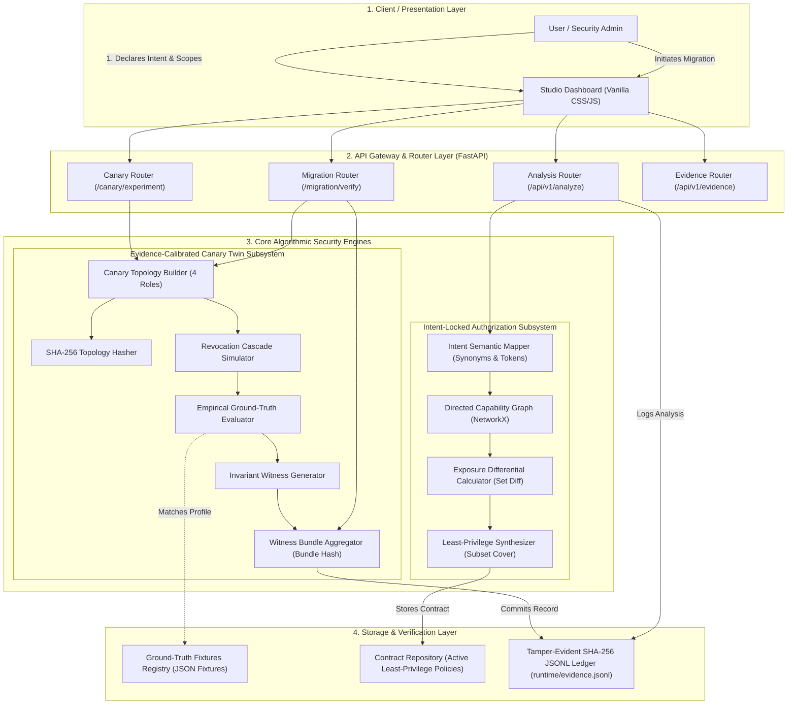
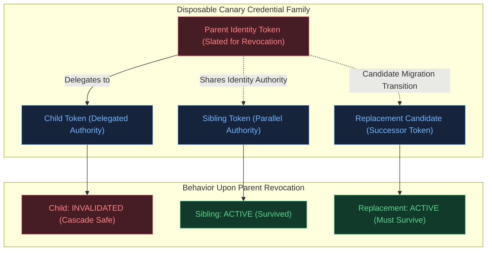

# ScopeSentry-R: Architecture and Workflow Diagrams

This document provides formal architectural diagrams, execution flowcharts, and component interaction models for **ScopeSentry-R: Evidence-Calibrated Canary Revocation Twin with Intent-Locked Authorization**. You can include these Mermaid diagrams directly into your presentation slides, final thesis report, and project viva documentation.

---

## 1. High-Level System Architecture Diagram

---

## 2. End-to-End System Workflow Diagram

This flowchart illustrates the end-to-end sequence: from raw user input to final authorization decision and tamper-evident audit commitment.

```mermaid
sequenceDiagram
    autonumber
    actor Developer as Developer / App
    participant Studio as ScopeSentry Studio
    participant IntentEng as Intent & Capability Engine
    participant CanaryEng as Canary Revocation Engine
    participant CalibReg as Calibration Fixture Registry
    participant Gate as Migration Verification Gate
    participant Ledger as Tamper-Evident Ledger

    %% PHASE 1: INTENT LOCKING
    rect rgb(20, 35, 60)
        Note over Developer,IntentEng: Phase 1: Intent-Locked Least-Privilege Synthesis
        Developer->>Studio: Declares Natural Language Intent + Requested Scopes
        Studio->>IntentEng: POST /api/v1/analyze
        IntentEng->>IntentEng: Traverse Directed Capability Graph
        IntentEng->>IntentEng: Compute Exposure Differential (Granted vs Required)
        alt Excessive Scopes Present
            IntentEng-->>Studio: Status: EXCESSIVE AUTHORITY (Isolate unneeded scopes, 50% risk drop)
        else Scopes Match Intent
            IntentEng-->>Studio: Status: LEAST PRIVILEGE
        end
    end

    %% PHASE 2: CANARY SYNTHESIS & CALIBRATION
    rect rgb(30, 45, 75)
        Note over Studio,CalibReg: Phase 2: Canary Revocation Twin & Calibration
        Studio->>CanaryEng: POST /migration/verify (Provider, Version, Scopes)
        CanaryEng->>CanaryEng: Synthesize 4 Roles (Parent, Child, Sibling, Replacement)
        CanaryEng->>CanaryEng: Calculate Deterministic SHA-256 Topology Hash
        CanaryEng->>CanaryEng: Simulate Parent Identity Revocation
        CanaryEng->>CalibReg: Lookup Ground-Truth Profile (Provider + Version)
        
        alt No Ground-Truth Profile Found
            CalibReg-->>Gate: Calibration Verdict: UNSUPPORTED
            Gate-->>Studio: Decision: INDETERMINATE (Failsafe Rejection)
        else Profile Found & Invariants Divergent (e.g., Replacement Killed)
            CalibReg-->>Gate: Calibration Verdict: DIVERGENT
            Gate-->>Studio: Decision: REJECTED (Fault Detected)
        else Profile Matches Simulator Perfectly
            CalibReg-->>Gate: Calibration Verdict: CALIBRATED (e.g. 98% Confidence)
            Gate->>Gate: Generate 4 Invariant Witnesses
            Gate->>Gate: Compute Merkle Bundle Digest
            Gate-->>Studio: Decision: APPROVED
        end
    end

    %% PHASE 3: AUDIT COMMITMENT
    rect rgb(15, 30, 50)
        Note over Gate,Ledger: Phase 3: Tamper-Evident Evidence Commitment
        Gate->>Ledger: Append Record (Sequence #, Prev Hash, Record Hash)
        Ledger-->>Studio: Return Stable Evidence Reference
        Studio-->>Developer: Migration Approved with Cryptographic Audit Trail
    end
```

---

## 3. The 4-Role Canary Credential Dependency Graph

This diagram shows the exact structural relationship generated during canary credential family synthesis:

---

## 4. Tamper-Evident Cryptographic Ledger Architecture

This diagram illustrates how SHA-256 chaining ensures zero-trust mathematical immutability on disk:

```mermaid
graph LR
    subgraph BlockN1["Record #17"]
        P17["Prev Hash: 4a2f..."]
        D17["Payload (Canary Verification)"]
        H17["Record Hash: 8b1c..."]
        P17 --- D17 --- H17
    end

    subgraph BlockN2["Record #18 (Target of Attack)"]
        P18["Prev Hash: 8b1c..."]
        D18["Payload (Altered Byte)"]
        H18["Record Hash: a93e..."]
        P18 --- D18 --- H18
    end

    subgraph BlockN3["Record #19"]
        P19["Prev Hash: a93e..."]
        D19["Payload (Analysis Event)"]
        H19["Record Hash: f04d..."]
        P19 --- D19 --- H19
    end

    H17 -->|Cryptographic Link| P18
    H18 -->|Cryptographic Link| P19

    classDef tampered fill:#461c25,stroke:#ff8585,color:#ff8585;
    classDef valid fill:#123a2b,stroke:#55d68b,color:#55d68b;

    class BlockN1 valid;
    class BlockN2 tampered;
    class BlockN3 tampered;
```

> **Cryptographic Proof Mechanism:**  
> If an attacker modifies even a single character in **Record #18**, recalculating $\text{SHA-256}(\text{Record } 18)$ produces a mismatch with $H_{18}$. Furthermore, $P_{19}$ in **Record #19** no longer matches the true hash of Record 18, severing the entire chain of custody and raising an immediate HTTP `409 Conflict`.
